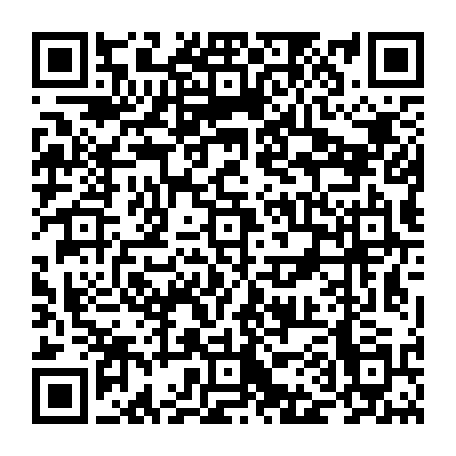

# Apoiar o Maracujá

Se o Maracujá te ajuda e você quiser apoiar o projeto, qualquer valor é bem-vindo.
O apoio é voluntário. O aplicativo continua completo e gratuito, com os mesmos
recursos para todas as pessoas.

<p align="center">
  
</p>

Abra o leitor de QR do seu banco ou use o código **Pix copia e cola**:

```text
00020101021126580014br.gov.bcb.pix0136fc35662c-a90f-4f00-bdc7-a490618c69665204000053039865802BR5908MARACUJA6008BLUMENAU62070503***6304A462
```

Chave aleatória: `fc35662c-a90f-4f00-bdc7-a490618c6966`.

O QR é estático, sem valor fixo nem vencimento. O banco mostra o titular real da
chave: confira o destinatário e o valor antes de confirmar. O projeto não recebe
senhas ou dados bancários, não verifica pagamentos e não condiciona o uso do app
a uma doação. O código continua utilizável enquanto a chave permanecer ativa.

No aplicativo, a mesma opção fica em **⋯ → Apoiar o Maracujá**. Ela só abre quando
você a escolhe. O botão **Copiar Pix** copia o mesmo código mostrado acima; abrir
a janela ou ler o QR não inicia um pagamento.

## Sobre o QR

Os campos usam a identificação `MARACUJA` e a cidade `BLUMENAU`, com a chave
aleatória informada pelo responsável pelo projeto. O nome mostrado no banco vem
do cadastro da chave, conforme o [padrão do Banco Central](https://www.bcb.gov.br/content/estabilidadefinanceira/pix/Regulamento_Pix/II_ManualdePadroesparaIniciacaodoPix.pdf).

Os arquivos SVG e PNG são gerados localmente pelo script
[`packaging/generate_support_pix.py`](packaging/generate_support_pix.py), usando a
versão e o hash fixados do gerador QR. Não há biblioteca QR, serviço de pagamento
ou acesso à rede durante o uso dessa opção no aplicativo.
